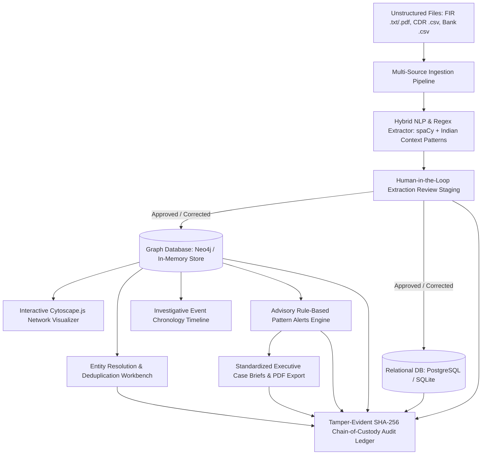

# AI-Powered Criminal Network Analysis System (Decision-Support Tool)
### Smart India Hackathon — Problem Statement ID: 26189
**Organisation:** Ministry of Home Affairs | **Department:** NCRB, Women Safety Division

---

> [!IMPORTANT]
> **Decision-Support Only. Not a determination of guilt or risk. All findings require human investigator review.**
> This software is strictly an investigative decision-support tool. It never determines guilt or innocence, makes automated arrests, or generates predictive policing risk scores. All data utilized in testing and demonstration is **100% synthetic and fictional**.

---

## 1. System Architecture Overview

The system is organized into modular phases supporting end-to-end investigative workflows:



---

## 2. Quick Start

### Prerequisites
- Python 3.10+
- Node.js 18+ & npm
- (Optional) Docker & Docker Compose

### Running Backend (FastAPI)
```bash
# 1. Enter backend directory
cd backend

# 2. Setup virtual environment & dependencies
python3 -m venv .venv
source .venv/bin/activate
pip install -r requirements.txt
python -m spacy download en_core_web_sm

# 3. Seed synthetic database
python -m app.seed.seed_data

# 4. Start backend server
uvicorn app.main:app --host 0.0.0.0 --port 8000 --reload
```
- **Backend API URL:** `http://localhost:8000/api`
- **Interactive Swagger Documentation:** `http://localhost:8000/docs`

### Running Frontend (React + Vite)
```bash
cd frontend
npm install
npm run dev
```
- **Web Application:** `http://localhost:5173`

---

## 3. Demo Credentials

The database is initialized with 3 role-based demo accounts:

| Username | Password | Role | Privileges |
|---|---|---|---|
| `investigator1` | `Investigator@123` | `investigator` | Document ingestion, staging review, graph discovery, alerts review |
| `supervisor1` | `Supervisor@123` | `supervisor` | All investigator tools + entity merge authorization & audit ledger verification |
| `admin1` | `Admin@123` | `administrator` | Full system administration, audit log management & system configuration |

---

## 4. Key Functional Capabilities

### Phase 1: Core Graph Network & Cryptographic Audit
- **Cytoscape.js Dark Network Canvas (`#0B0D1B`):** Physics layout with multi-hop neighbor expansion, node profile drawer, and edge evidence panel.
- **Traceable Evidentiary Citations:** Every graph relationship links directly to originating source records (`REC-000XXX`) with raw text context and confidence ratings.
- **Tamper-Evident SHA-256 Audit Chain:** Cryptographically hash-chains every user action with an interactive verification ledger.

### Phase 2: Ingestion, NLP Extraction & Entity Deduplication
- **Multi-Format Ingestion:** Ingests unstructured FIR reports (`.txt`, `.pdf`), cellular CDR dumps (`.csv`), banking ledgers (`.csv`), and surveillance logs.
- **Hybrid NLP Extractor:** Combines spaCy NER (`en_core_web_sm`) with domain regexes for Indian phone numbers (`+91 9XXXX XXXXX`), vehicle plates (`DL-01-AB-1234`), bank accounts (`A/C XXXXXXXXXXXX`), and IFSC codes.
- **Human-in-the-Loop Review Staging:** Staging table where investigators approve, correct (`EntityCorrectionModal`), or reject candidate entities.
- **Entity Resolution Workbench:** Token overlap & sequence similarity algorithms to surface candidate duplicates with supervisor merge authorization.
- **Event Chronology Timeline:** Unified timeline correlating cellular calls, wire transfers, field sightings, and FIR registrations.

### Phase 3: Rule-Based Pattern Alerts & Executive PDF Briefs
- **Deterministic Pattern Alerts Engine:**
  1. *Multi-Record Co-Occurrence:* Persons appearing together across $\ge 2$ distinct records.
  2. *High-Frequency Communication Bridge:* Hub nodes connecting multiple contact nodes across CDR logs.
  3. *Circular Financial Flow:* Cyclical and round-trip banking wire transfers ($A \rightarrow B \rightarrow A$).
  4. *Shared High-Risk Identifier:* Multiple individuals sharing the same phone, vehicle, or bank account.
- **Executive Case Briefs & PDF Reporting:** Court-admissible case summaries generated with `reportlab`, containing case metadata, executive narrative, discovered entities tables, relationship citations, active alerts, and SHA-256 digital chain-of-custody custody seals.

---

## 5. Verification & Testing

### Run Pytest Suite (11/11 Passed - 100%)
```bash
cd backend
PYTHONPATH=. .venv/bin/pytest tests -v
```

### Run Live End-to-End Verification
```bash
python verify_phase3_live.py
```

### Run Frontend Production Build
```bash
cd frontend
npm run build
```

---

## 6. Ethics, Privacy & Legal Directives

1. **Strictly Decision-Support Only:** Never determines guilt or automates enforcement decisions.
2. **0 Banned Labels:** Zero occurrences of `"criminal"`, `"mastermind"`, `"kingpin"`, `"suspect score"`, `"threat level"`, or `"risk score"`.
3. **Mandatory Disclaimer Banner:** Placed on all pages, drawers, modals, and PDF exports.
4. **Privacy Protection:** Phone numbers and bank accounts masked by default with audited unmasking.
5. **100% Synthetic:** All demo cases, persons, and records are fictional and synthetic.
